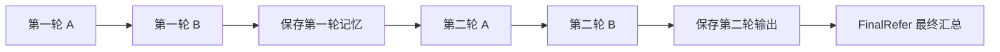

# 两个智能体、两轮固定通信图的离线版本

## 运行

在 `ad-l` 环境、AD-L 项目根目录执行：

```bash
python scripts/run_fixed_graph.py --output results/fixed_graph/demo.json
python scripts/run_fixed_graph.py --async --output results/fixed_graph/demo-async.json
python -m unittest discover -s tests -v
```

此入口仅支持 `mock` 后端，关闭追踪，不加载 `.env`。模拟回答由配置提供，不会根据题目计算答案，也不能据此报告模型正确率。

角色固定为 A＝GSM8K Math Solver、B＝GSM8K Mathematical Analyst；两个角色都来自原项目的 `MathSolver` 类。最终决策使用原 `experiments/run_gsm8k.py` 默认的 `FinalRefer`。

角色与汇总提示词保存在 `src/ad_l/resources/prompts/math_collaboration_prompts.json`，该文件包含系统提示词、few-shot 示例和来源信息。

## 默认执行与消息可见性



图中的箭头表示执行顺序。实际传给模型的消息仅按通信连接筛选，不会把全部共享状态传入每个智能体。

| 调用 | 本轮可见回答 | 上轮可见回答 |
|---|---|---|
| 第一轮 A | 无 | 无 |
| 第一轮 B | 第一轮 A | 无 |
| 第二轮 A | 无 | 无 |
| 第二轮 B | 第二轮 A | 第一轮 A |
| 最终汇总 | 第二轮 A、第二轮 B | 无 |

每轮结束才生成上一轮输出快照；新一轮的输出写入单独的 `current_outputs`，不覆盖 `previous_outputs`。汇总节点只接收最后一轮两名智能体的输出，不额外拼接第一轮历史。智能体按原规则重新构造系统／用户两条消息，没有额外累计聊天记录。

## 配置矩阵与原项目的实际行为

`configs/fixed_graph_offline.json` 中矩阵行表示来源，列表示接收者，顺序都是 A、B：

```json
{
  "spatial_masks": [[0, 1], [0, 0]],
  "temporal_masks": [[1, 1], [1, 1]]
}
```

空间矩阵指定本轮 A→B。时间矩阵虽然全为 1，原项目在 `optimized_temporal=False` 的固定分支中仍调用基于空间图的 `check_cycle`。因此自连接和跨轮 B→A 被过滤，第二轮实际只保留“上一轮 A→本轮 B”。第一轮不建立时间连接。

本版按原节点顺序逐行构造空间边，保留同样的环路过滤行为；例如空间候选同时包含 A→B、B→A 时，A→B 先被接受，B→A 被过滤。没有把候选矩阵直接当作实际通信图。结果中分别保存配置矩阵和 `effective_topology`，避免将未生效的连接当作已使用。

这是对原代码行为的迁移。若后续希望跨轮通信允许自连接或反向连接，应作为算法／语义变更单独实现和验证。

## 保留与限制

- 保留两个角色的系统提示词、few-shot 示例、消息拼接与提示用答案提取函数，包括原函数处理负数、小数时的既有行为。
- 保留 `FinalRefer` 的系统／用户提示词、示例，以及按 A、B 顺序传入最终输出的规则。
- 提示词和原函数均存于本项目，不依赖运行时访问原项目；原文件 SHA-256 保存在资源 JSON 中。
- 支持同步 `invoke` 和异步 `ainvoke`。轮内仍按原图的顺序执行；异步接口不表示两个有依赖关系的节点会同时执行。
- 每次调用按角色和轮次选取预设响应，并创建独立模拟客户端，不共享响应游标。重复运行和同一张编译图的并发任务互不混入消息。
- 仅迁移两角色、两轮、固定连接的正常执行路径；模型错误直接终止。未迁移原调度器的失败重试、超时策略、跳过节点、动态采样或训练／剪枝。
- 未引入训练梯度张量，也没有启用流程检查点。

## 记录与验证

输出 JSON 保存任务、角色、原始配置、实际连接、模型配置、随机种子、库版本、每次调用的可见输入／完整消息／输出、每轮回答、最终回答、调用次数和耗时。手工输入标为 `data_split=manual`；模拟 Token 用量为 `null`，来源标为 `mock_not_measured`；真实模型请求为 0。固定模拟过程不使用随机采样，保存的本地种子不代表真实模型可复现性。

新增测试覆盖 5 次调用的顺序、第一轮无时间信息、跨轮快照、最后一轮汇总、断边后的隔离、同步／异步一致、重复／并发任务隔离、错误立即终止、配置验证与离线命令行结果。

迁移对照测试只抽取原项目的类／方法和纯函数定义，接入本地预设响应，运行原 `Graph.arun`、`Node` 消息访问逻辑与原提示词构造，不导入原模型模块，不访问密钥。在默认、反向空间边、双向空间候选、无空间边、无时间边五种配置下，逐次对照全部输入消息、可见回答和最终输出。原项目不可用时只跳过这些对照测试。

实现使用 [LangGraph Graph API](https://docs.langchain.com/oss/python/langgraph/graph-api)；图节点负责执行，消息可见性由单独的通信连接决定。
