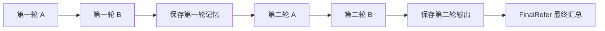

# 两个智能体、两轮固定通信图与模型注入

## 运行

在 `ad-l` 环境、AD-L 项目根目录执行：

```bash
python run.py
python run.py --async
python -m unittest discover -s tests -v
```

此入口默认 `mock` 后端，关闭追踪；模拟模式不加载 `.env`。模拟回答由配置提供，不会根据题目计算答案，也不能据此报告模型正确率。原离线入口 `build_offline_fixed_graph` 继续可用，与新的 `build_fixed_graph` 共用执行流程。

## DeepSeek 配置

在项目根目录创建本地 `.env`（参考 `.env.example`），填写：

```dotenv
DEEPSEEK_API_KEY=填写你的密钥
DEEPSEEK_BASE_URL=https://api.deepseek.com
DEEPSEEK_MODEL=填写账户可用的模型名称
LANGSMITH_TRACING=false
```

`.env` 已被 Git 忽略。密钥只填本地文件或环境变量；程序不会将密钥或客户端对象写入结果。已有环境变量优先于 `.env`。

```bash
python run.py --deepseek
```

`--deepseek` 等同于 `--backend deepseek --allow-real-api`，这条命令会发送真实请求，成功执行共 5 次。结果自动保存到 `results/fixed_graph/` 的独立 JSON 文件，终端会显示完整路径；可添加 `--output` 指定位置。可添加 `--async`，或使用 `--model`、`--temperature`、`--max-tokens`、`--timeout` 指定参数。默认温度和输出长度继续省略，超时为 60 秒，自动重试为零。失败后立即停止，保存记录并以非零状态退出。原 `scripts/run_fixed_graph.py` 入口继续可用。

离线配置文件中的 `backend=mock` 表示预设回答场景；真正选择模型后端使用命令行 `--deepseek` 或 `--backend`。真实模式沿用该文件的连接矩阵，忽略预设回答。结果中真实模式仅保存连接配置，避免把模拟场景误认为模型输出。

## 程序中注入适配器

```python
from pathlib import Path
from langsmith import tracing_context
from ad_l.fixed_graph import build_fixed_graph, load_fixed_graph_config
from ad_l.models import create_model_adapter

config = load_fixed_graph_config(Path("configs/fixed_graph_offline.json"))
adapters = {node: create_model_adapter(mock_response=f"{node}: The answer is 5")
            for node in ("A", "B", "final")}
graph = build_fixed_graph(config, adapters)
with tracing_context(enabled=False):
    result = graph.invoke({"task": "3 + 2?"})
```

映射必须包含 A、B、final，可分别配置不同模型。真实适配器在创建和注入图时都需要显式 `allow_real_api=True`。命令行的三个节点共用一个无会话记忆的 DeepSeek 适配器；每次只传入该节点按通信规则可见的两条消息。自定义有响应游标的模拟适配器由调用方管理；默认离线入口仍为每次调用创建独立模拟客户端。

角色固定为 A＝GSM8K Math Solver、B＝GSM8K Mathematical Analyst；两个角色都来自原项目的 `MathSolver` 类。最终决策使用原 `experiments/run_gsm8k.py` 默认的 `FinalRefer`。

角色与汇总提示词保存在 `src/ad_l/resources/prompts/math_collaboration_prompts.json`，该文件包含系统提示词、few-shot 示例和来源信息。

## 默认执行与消息可见性



图中的箭头表示执行顺序。实际传给模型的消息仅按通信连接筛选，不会把全部共享状态传入每个智能体。

| 调用 | 本轮可见回答 | 上轮可见回答 |
|---|---|---|
| 第一轮 A | 无 | 无 |
| 第一轮 B | 第一轮 A | 无 |
| 第二轮 A | 无 | 无 |
| 第二轮 B | 第二轮 A | 第一轮 A |
| 最终汇总 | 第二轮 A、第二轮 B | 无 |

每轮结束才生成上一轮输出快照；新一轮的输出写入单独的 `current_outputs`，不覆盖 `previous_outputs`。汇总节点只接收最后一轮两名智能体的输出，不额外拼接第一轮历史。智能体按原规则重新构造系统／用户两条消息，没有额外累计聊天记录。

## 配置矩阵与原项目的实际行为

`configs/fixed_graph_offline.json` 中矩阵行表示来源，列表示接收者，顺序都是 A、B：

```json
{
  "spatial_masks": [[0, 1], [0, 0]],
  "temporal_masks": [[1, 1], [1, 1]]
}
```

空间矩阵指定本轮 A→B。时间矩阵虽然全为 1，原项目在 `optimized_temporal=False` 的固定分支中仍调用基于空间图的 `check_cycle`。因此自连接和跨轮 B→A 被过滤，第二轮实际只保留“上一轮 A→本轮 B”。第一轮不建立时间连接。

本版按原节点顺序逐行构造空间边，保留同样的环路过滤行为；例如空间候选同时包含 A→B、B→A 时，A→B 先被接受，B→A 被过滤。没有把候选矩阵直接当作实际通信图。结果中分别保存配置矩阵和 `effective_topology`，避免将未生效的连接当作已使用。

这是对原代码行为的迁移。若后续希望跨轮通信允许自连接或反向连接，应作为算法／语义变更单独实现和验证。

## 保留与限制

- 保留两个角色的系统提示词、few-shot 示例、消息拼接与提示用答案提取函数，包括原函数处理负数、小数时的既有行为。
- 保留 `FinalRefer` 的系统／用户提示词、示例，以及按 A、B 顺序传入最终输出的规则。
- 提示词和原函数均存于本项目，不依赖运行时访问原项目；原文件 SHA-256 保存在资源 JSON 中。
- 支持同步 `invoke` 和异步 `ainvoke`。轮内仍按原图的顺序执行；异步接口不表示两个有依赖关系的节点会同时执行。
- 默认模拟调用按角色和轮次选取预设响应，并创建独立模拟客户端，不共享响应游标。重复运行和同一张编译图的并发任务互不混入消息。
- 迁移两角色、两轮、固定连接的执行路径；模型调用失败会记录错误并终止后续调用。未迁移原调度器的失败重试、超时策略、跳过节点、动态采样或训练／剪枝。
- 未引入训练梯度张量，也没有启用流程检查点。

## 记录与验证

输出 JSON 的 `schema_version=2`。每次调用保存节点、轮次、可见输入、完整消息、模型配置、UTC 开始时间、耗时、成功／失败状态、回答、Token 用量及来源。失败只保存异常类型和可用的 HTTP 状态码，不保存可能含凭据的异常原文。

顶层 `status` 表示本次运行结果。`trace` 保留已完成调用和失败尝试；`current_outputs` 中的部分轮次输出可通过成功调用的 trace 恢复。失败时不会用未完成的输出继续汇总。

`usage` 仅在所有调用均返回用量时给出总和，否则为 `null`；`known_usage` 是已返回用量的小计，不能视作完整实际用量，`usage_complete` 表示是否齐全。模拟用量来源为 `mock_not_measured`。真实模式中，每次用量来自提供方；缺失用量或失败会使顶层来源为 `provider_incomplete`。

`model_calls` 是调用适配器的尝试次数，`real_api_calls` 是其中的真实后端尝试次数，包含失败尝试；超时／连接错误时不能据此断言服务端实际处理或计费次数。固定图要求 `max_retries=0`，不隐藏重试。只有成功完成才有最终回答。记录还包含任务、数据划分、随机种子、库版本、提示词来源和每轮输出；手工输入仍为 `data_split=manual`，本地种子不代表真实生成可复现性。

新增测试覆盖 5 次调用的顺序、第一轮无时间信息、跨轮快照、最后一轮汇总、断边后的隔离、同步／异步一致、重复／并发任务隔离、错误立即终止、配置验证与离线命令行结果。

迁移对照测试只抽取原项目的类／方法和纯函数定义，接入本地预设响应，运行原 `Graph.arun`、`Node` 消息访问逻辑与原提示词构造，不导入原模型模块，不访问密钥。在默认、反向空间边、双向空间候选、无空间边、无时间边五种配置下，逐次对照全部输入消息、可见回答和最终输出。原项目不可用时只跳过这些对照测试。

实现使用 [LangGraph Graph API](https://docs.langchain.com/oss/python/langgraph/graph-api)；图节点负责执行，消息可见性由单独的通信连接决定。
